  <a href="README.md">简体中文</a> | <strong>English</strong>

## MTUN-XD

**A Mihomo management suite for OpenWrt / iStoreOS — stable by design.**

MTUN-XD bundles the Mihomo core, the MetaCubeXD dashboard, a browser-based config
generator and maintenance tooling into a single LuCI entry (**Services → MTUN-XD**).
One command to install; component updates do not drop the network.

- **Auditable config** — deterministic key order, diff-friendly output.
- **Clear boundaries** — no automatic core restarts or file deletions.
- **Verifiable quality** — 176 self-checks and Golden baselines.

### Repositories

| Repository | What it is |
| --- | --- |
| [genkit](https://github.com/OpenWrt-MTUN-XD/genkit) | Rolling release kit for the config tool (runtime component) |
| [.github](https://github.com/OpenWrt-MTUN-XD/.github) | Organization profile and assets |
| [Sbox-XD](https://github.com/OpenWrt-MTUN-XD/Sbox-XD) | A separate project: modern sing-box GUI client |
| [OpenWrt-MTUN-XD](https://github.com/OpenWrt-MTUN-XD/OpenWrt-MTUN-XD) | The suite: installer, LuCI app, config generator |

### Links

[Releases](https://github.com/OpenWrt-MTUN-XD/OpenWrt-MTUN-XD/releases) ·
[Telegram](https://t.me/+Kdxyw8yLTz85ODg5) ·
[Contributing](https://github.com/OpenWrt-MTUN-XD/OpenWrt-MTUN-XD/blob/main/CONTRIBUTING.md) ·
[Security](https://github.com/OpenWrt-MTUN-XD/OpenWrt-MTUN-XD/blob/main/SECURITY.md) ·
[Trademark](https://github.com/OpenWrt-MTUN-XD/OpenWrt-MTUN-XD/blob/main/TRADEMARK.md)
