  <a href="README.md">English</a> | <strong>简体中文</strong>

## MTUN-XD（墨枢云境）

**OpenWrt / iStoreOS 的 Mihomo 管理套件 —— 稳定优先。**

套件把 Mihomo 核心、MetaCubeXD 面板、浏览器端配置生成器与维护工具，收进 LuCI 的
**「服务 → MTUN-XD」** 统一入口。一条命令装好；组件升级不断网。

- **配置可审计**：固定键序，输出可 Diff。
- **边界清晰**：不自动重启内核、不自动删文件。
- **质量可验证**：176 项自检与 Golden 基线。

### 仓库

| 仓库 | 说明 |
| --- | --- |
| [OpenWrt-MTUN-XD](https://github.com/OpenWrt-MTUN-XD/OpenWrt-MTUN-XD) | 套件本体：安装脚本、LuCI 应用、配置生成器 |
| [genkit](https://github.com/OpenWrt-MTUN-XD/genkit) | 配置工具的滚动发布包（运行时组件） |
| [Sbox-XD](https://github.com/OpenWrt-MTUN-XD/Sbox-XD) | 独立项目：sing-box 现代化 GUI 客户端 |
| [.github](https://github.com/OpenWrt-MTUN-XD/.github) | 组织主页与素材 |

### 链接

[版本发布](https://github.com/OpenWrt-MTUN-XD/OpenWrt-MTUN-XD/releases) ·
[Telegram 群组](https://t.me/+Kdxyw8yLTz85ODg5) ·
[参与开发](https://github.com/OpenWrt-MTUN-XD/OpenWrt-MTUN-XD/blob/main/CONTRIBUTING.md) ·
[安全报告](https://github.com/OpenWrt-MTUN-XD/OpenWrt-MTUN-XD/blob/main/SECURITY.md) ·
[品牌与商标](https://github.com/OpenWrt-MTUN-XD/OpenWrt-MTUN-XD/blob/main/TRADEMARK.md)

